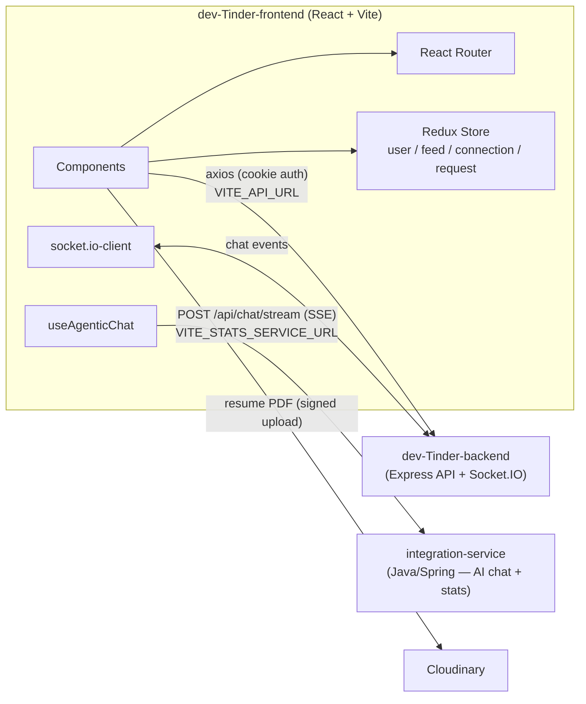
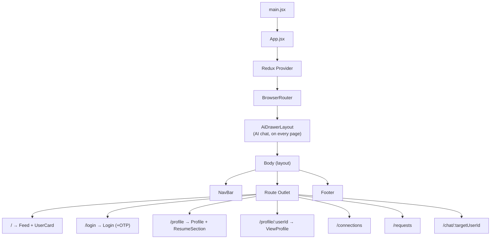
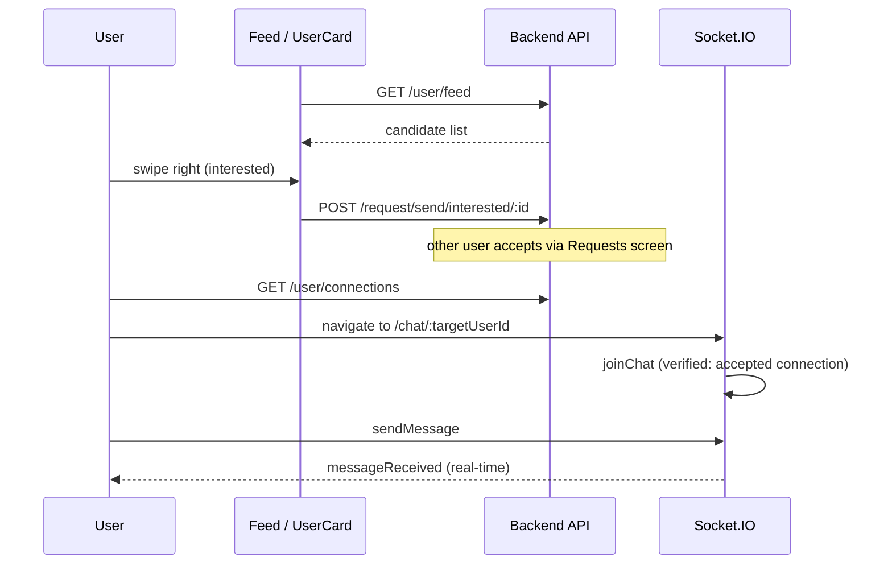

# DevTinder — Frontend

React 19 + Vite single-page app for **DevTinder**. Swipe-style developer matching, real-time chat, resume upload, and a global AI recruiter chat drawer backed by the [integration-service](../integration-service).

## Tech stack

| Concern | Choice |
|---|---|
| Framework | React 19 + Vite 7 |
| Routing | React Router DOM v7 (`BrowserRouter`) |
| State | Redux Toolkit (`user`, `feed`, `connection`, `request` slices) |
| Styling | Tailwind CSS v4 + daisyUI |
| Animation | Framer Motion (swipe cards, AI drawer) |
| Real-time | `socket.io-client` |
| Notifications | react-toastify |

## Architecture



The "AI Recruiter" chat drawer uses `VITE_STATS_SERVICE_URL` to reach the integration service. Local development forwards SSE through Vite's `/integration-api` proxy; production connects to the configured service directly. Stats are fetched through the Node backend's `/stats` proxy.

## App structure



## Key user flow: swipe → connect → chat



## Components (`src/components/`)

| Component | Purpose |
|---|---|
| `Body.jsx` | Root layout; restores session from cookie on mount, redirects to login if unauthenticated |
| `NavBar.jsx` | Top nav, pending-request indicator, logout |
| `Footer.jsx` | Static footer |
| `Login.jsx` + `OtpCoundown.jsx` | Combined login/signup with OTP verification |
| `Feed.jsx` + `UserCard.jsx` | Swipeable candidate stack (Framer Motion), on-demand GitHub/Codeforces/LeetCode stats |
| `Requests.jsx` / `RequestCard.jsx` | Incoming connection requests — accept/reject |
| `Connections.jsx` / `ConnectionCard.jsx` | Accepted connections list |
| `Profile.jsx` / `ProfileEdit.jsx` | Profile editing |
| `ResumeSection.jsx` | Direct-to-Cloudinary resume upload; triggers backend ingestion webhook |
| `ViewProfile.jsx` | Read-only profile view of another user |
| `Chat.jsx` | 1:1 real-time chat over Socket.IO |
| `AiDrawerLayout.jsx` | Global AI recruiter chat drawer (streams from integration-service) |
| `Toast.jsx` | Toast notification container |

## State (`src/utils/`)

| File | Purpose |
|---|---|
| `appStore.js` | Redux Toolkit store combining all slices |
| `userSlice.js`, `feedSlice.js`, `connectionsSlice.js`, `requestsSlice.js` | Simple `add*`/`remove*` reducers; data fetching happens in components via axios |
| `constants.js` | `BASE_URL` from `VITE_API_URL` |
| `socket.js` | `createSocketConnection()` — Socket.IO client factory |

## Run guide

### Prerequisites
- Node.js 18+
- [dev-Tinder-backend](../dev-Tinder-backend) running (default `http://localhost:7777`)
- (Optional, for the AI chat drawer) [integration-service](../integration-service) running on `http://localhost:8080`

### 1. Install

```bash
cd dev-Tinder-frontend
npm install
```

### 2. Configure environment

Create a `.env` file in `dev-Tinder-frontend/` with:

```env
VITE_API_URL=http://localhost:7777
VITE_STATS_SERVICE_URL=http://localhost:8080
VITE_AI_CHAT_ENABLED=false
```

Local HTTP API calls use `/api` on the Vite server, which forwards requests to
`VITE_API_URL` and preserves authentication cookies. This avoids browser CORS
preflights between ports 5173 and 7777 for profile saving and resume updates.
Restart Vite after changing the proxy target. Production builds use
`VITE_API_URL` directly; human-chat WebSockets also connect to that URL directly.

AI chat uses `VITE_STATS_SERVICE_URL`. Start the integration service separately:
Docker Desktop alone does not start it. Verify `http://localhost:8080/api/ping`
before sending a chat request. On Netlify, set this variable to the deployed
integration service's HTTPS base URL and rebuild; localhost refers to the visitor's
own computer.

AI chat is enabled only when `VITE_AI_CHAT_ENABLED` is exactly `true`. With
`false` or a missing value, the AI drawer is hidden and both frontend AI chat
request paths are blocked. Human chat remains available. Restart Vite after
changing your local `.env`.

On Netlify, add `VITE_AI_CHAT_ENABLED` in **Project configuration > Environment
variables**, make it available to the build, and set its production value to
`true` to enable chat or `false` to disable it. Trigger a new build and deploy
after each change: Vite embeds the flag into the generated JavaScript, so it
cannot change a deployment that is already built. Existing open tabs need to
reload to receive the new version.

This flag controls the frontend only. Direct requests to the integration-service
API and other LLM features, such as resume embeddings, require server-side
controls to enforce a spending limit.

### Resume previews in AI chat

AI answers now include resume source metadata from the integration service.
Click a blue resume citation or a **Resumes used** button to view the PDF beside
the chat on desktop. On mobile the preview fills the panel; **Back to chat**
returns to the conversation. The preview also includes **Open in new tab** for
browsers that cannot embed the PDF. Opening a resume does not call the LLM.

Deploy the frontend, Node backend and integration service together, then reload.
Resume replacement saves a new version ID before retiring the old file, Mongo
chunks and Pinecone vectors. Removing a resume also removes its search data.
Only the current version can supply context or citations for new AI answers.
Existing chat answers are checked when opening the drawer, regaining focus,
every 30 seconds while the drawer is open, and before opening a PDF. An answer
using a retired resume is cleared with a request to ask again for current
information. These checks and deletions make no LLM or embedding calls; indexing
the newly uploaded PDF still makes embedding calls.

Run the proxy, citation and streaming regression checks with
`node --test tests/apiProxy.test.mjs tests/resumeSources.test.mjs tests/sseParser.test.mjs`.

### 3. Run

```bash
npm run dev
```

Vite serves the app at `http://localhost:5173` by default.

### 4. Other scripts

```bash
npm run build     # production build to dist/
npm run preview   # preview the production build locally
npm run lint      # eslint
```
