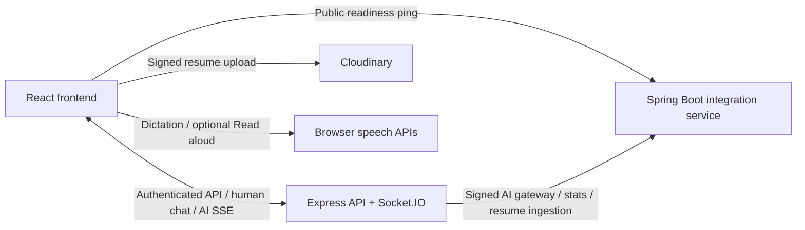

# DevTinder Frontend

DevTinder's React application for discovering developers, managing connections, sharing resumes, and chatting with people or an AI recruiter.

This repository is the frontend. The Express API and Spring Boot integration service remain separate repositories.

## Android application

The same frontend now includes a Capacitor Android project in `android/`, with native secure sessions, dictation, Read aloud, private PDF preview, and Firebase notification bridges. Web builds still produce `dist/`; Android bundles produce `dist-android/`. APK updates are separate from Netlify deployments.

See [Android development](docs/android/README.md), [Firebase configuration](docs/android/FIREBASE.md), and [release gates](docs/android/RELEASE.md). Firebase credentials, release signing, deployed mobile APIs, and real-device validation are prerequisites for distribution; adding source code does not configure or publish those services.

The public `/download` page provides the Android APK link and short installation steps, with extra help and release details collapsed. It mounts independently of session checks and backend warm-up, so downloading does not wake Render. Web visitors can reach it from **Get Android app** in the header or account menu. Web builds download the versioned GitHub Release asset, verify its size and SHA-256, and mirror it into `dist/downloads/` for a direct same-site Netlify download. No APK is committed to Git or copied into the native app bundle. GitHub remains an alternative download. See [APK distribution](docs/android/DISTRIBUTION.md) for publishing and update steps.

## Features

- **Accounts:** cookie-based login, signup with email OTP verification, profile editing, and logout. Web JWTs and login/signup cookies last one day; the backend also rejects older tokens after 24 hours.
- **Instant entry:** visitors without a remembered session see login/signup immediately while Node's session check and Spring's startup ping run in the background. Protected screens wait for backend session verification.
- **Developer discovery:** swipeable candidate cards, connection requests, accepted connections, and GitHub, Codeforces, and LeetCode statistics.
- **Live name search:** the header search shows matching profile cards directly below the header, with no separate Discover button, introduction, or duplicate field. Results update after a 300 ms debounce; `am` matches Aman, Amanda, and Amit by case-insensitive first/last-name prefix. Searches require two characters, exclude your own profile, and show 20 public profiles per page.
- **Request notifications:** the header loads pending requests after sign-in, shows a count with a gentle ripple, and refreshes on navigation, focus, reconnecting online, and every minute while visible. Reviewing requests updates the shared list and badge.
- **Human chat:** real-time text messaging over Socket.IO, with persisted history loaded from the backend.
- **AI recruiter:** a signed-in-only side panel with a fixed animated glass-globe launcher. The dedicated AI route opens the same conversation. Received task updates show a ripple on the current task; completed steps stay still.
- **Voice dictation:** optional English speech-to-text in both chats, with editable drafts and explicit sending.
- **Read aloud:** optional browser speech playback for completed AI answers.
- **Resumes:** upload, replace, and remove PDFs; inspect validated resume citations beside an AI conversation on desktop or in an overlay on mobile.
- **Visual design:** dark navy backgrounds, subtle geometric detail, a responsive header, compact chat composers, keyboard focus states, and reduced-motion support.

## Stack and architecture

| Area | Technology |
| --- | --- |
| Application | React 19, Vite 7, React Router 7 |
| State | Redux Toolkit and React context for transient chat state |
| Styling | Tailwind CSS 4, daisyUI, scoped CSS |
| Animation | Framer Motion for swipe cards; SVG/CSS for chat decoration |
| Networking | Axios, Fetch with SSE parsing, Socket.IO client |
| Feedback | react-toastify |
| Voice | Browser speech recognition and speech synthesis; no additional voice provider |



The integration service owns AI orchestration and its Gemini, Redis, MongoDB, and Pinecone integrations. Service setup is documented in its own repository.

### Development and production URLs

| Traffic | Development | Production |
| --- | --- | --- |
| HTTP API | Vite `/api` proxy to `VITE_API_URL` | Direct to `VITE_API_URL` |
| AI SSE | Vite `/api/ai/chat/stream` proxy to Node | Node `/ai/chat/stream` at `VITE_API_URL` |
| Spring readiness | Vite `/integration-api/api/ping` proxy | `VITE_STATS_SERVICE_URL` + `/api/ping` |
| Human WebSockets | Direct to `VITE_API_URL` | Direct to `VITE_API_URL` |
| Developer statistics | Backend `/stats` endpoint | Backend `/stats` endpoint |

The local HTTP proxies preserve cookies and avoid cross-port browser preflights. They are development-server features, not part of the production build.

### Integration service warm-up

When the frontend opens, it sends one non-blocking `GET /api/ping` to the integration service, including before login. Development uses the existing `/integration-api` proxy; production uses `VITE_STATS_SERVICE_URL`. A missing production service URL skips the request.

The startup ping is independent of the AI feature flag because developer statistics also use Spring. It sends no authentication cookies or request body, invokes no AI endpoint, and does not delay rendering or sign-in. It makes one quiet attempt per service URL per page load, with a three-minute limit; navigation does not repeat it.

When a signed-in user sends an AI question, the message waits in the conversation with a **Starting AI service** status. It shares any in-flight startup ping, or makes a fresh check because a previously ready service might have slept again. Chat is posted only after an HTTP success with the exact `Integration Service is up and running!` response. Render loading HTML, HTTP failures, network failures, and unreadable responses do not count as ready.

Only a waiting question retries health checks, every three seconds after a failed check, for at most three minutes. On timeout, the user sees that the question was not sent and can explicitly retry. The existing 130-second answer timeout starts after readiness; the chat POST is never automatically retried. Logout/account changes cancel the wait; simply closing and reopening the panel preserves it. There is no ongoing keep-alive after startup or a waiting question finishes.

The public Spring `/api/ping` endpoint allows cross-origin reads without credentials. Deploy its CORS change with this frontend update; otherwise a browser cannot confirm readiness. A successful health response confirms that Spring can serve HTTP, not that Gemini, Redis, or retrieval will necessarily succeed.

## Local development

### Prerequisites

- Node.js **20.19+ on the 20.x line, or 22.12+**, as required by Vite 7.
- The `dev-Tinder-backend` API, normally at `http://localhost:7777`.
- For enabled AI chat, a running `integration-service`, normally at `http://localhost:8080`.

Start the backend and integration service separately using their respective READMEs. Starting Docker Desktop alone does not start the integration service.

### Install and configure

From the workspace containing the three repositories:

```powershell
cd dev-Tinder-frontend
npm ci

# Preserve an existing local configuration.
if (!(Test-Path .env)) { Copy-Item .env.example .env }
```

Configure the frontend's `.env`:

```env
VITE_API_URL=http://localhost:7777
VITE_STATS_SERVICE_URL=http://localhost:8080
VITE_AI_CHAT_ENABLED=true
```

Use service base URLs without endpoint suffixes. Set `VITE_AI_CHAT_ENABLED=false` if the integration service is not being used.

Only the exact value `true` enables AI chat. A false or missing flag hides the launcher and blocks frontend AI queries, while human chat remains available. AI chat is also unavailable until the existing cookie session resolves to a signed-in account.

`VITE_*` values are public browser configuration. Keep Gemini, database, Redis, Cloudinary signing, and other secret credentials in the server services, not here. Local `.env` files are ignored by Git.

### Start

```sh
npm run dev
```

Open `http://localhost:5173` by default. Restart Vite after changing environment variables. For local AI connectivity, check the integration service's `/api/ping` endpoint before sending a query.

## Chat and voice behavior

### Initial visit and session restoration

The public login/signup form renders without waiting for either Render service. Opening a protected URL without a remembered session redirects locally to `/login` before mounting the protected screen or fetching its data. The existing `/profile/view` request wakes Node in the background; the independent Spring health ping starts on page load too.

After successful login, signup, or session restoration, the browser saves only a `devtinder.session-present=1` presentation hint. No token, password, profile, or conversation is stored in it. On a later visit, that hint shows a session-restoration screen while the backend verifies the HttpOnly cookie; it never grants access itself. An expired session clears the hint and opens login. A network/startup failure offers retry or sign-in instead. When storage is blocked, the form appears immediately and an existing cookie can still restore the account after verification.

Manual sign-in cancels the earlier background session check so a late response cannot overwrite the chosen account. Login/OTP/signup submissions show a waiting state and prevent duplicate submissions, with a three-minute request limit and no automatic credential retries. Login preserves the originally requested internal route; signup retains its existing profile-onboarding destination. Successful logout removes the hint.

### Text and drafts

Human chat uses authenticated `GET /chat/:targetUserId` history and Socket.IO `joinChat`, `sendMessage`, and `messageReceived` events. The server derives sender identity from the session, requires an accepted connection, and acknowledges persistence before the composer clears its draft. Canonical message IDs deduplicate history, broadcasts, and acknowledgements; they do not imply recipient delivery or read status.

AI chat posts `{ query }` to Node's authenticated `/ai/chat/stream`, which derives the user ID, signs its upstream request to Spring, and relays the existing SSE events. Node and Spring require the same server-only `AI_GATEWAY_SECRET`; deploy the coordinated gateway changes before this frontend. Never put that secret in a `VITE_*` variable.

- Enter sends; Shift+Enter inserts a newline.
- Drafts are separate for each conversation and stay in memory.
- Closing the AI panel preserves its conversation and pending query; reopening does not resubmit it.
- Logout, account changes, or a reload clear transient drafts and the AI transcript. Human message history remains on the backend.
- Opening an existing answer or resume preview does not issue another AI query.
- The notification count represents **pending connection requests**, not unread chat messages. Refreshing it uses the existing HTTP endpoint; it is not an instant push-notification channel.

### Dictation and playback

1. Click the microphone to start English (`en-IN`) dictation.
2. Stop and review the confirmed transcript, or Cancel to restore the original draft.
3. Edit the text and explicitly Send.

Capture ends after at most 60 seconds, or earlier if the browser ends recognition. Stopping, silence, or recognition completion never sends a message automatically. Typing remains available when speech recognition is unsupported or fails.

Desktop Chrome and Android Chrome are the primary browser targets. Brave can expose speech APIs while its recognition service is unavailable; the UI offers Chrome or device-keyboard dictation as fallbacks. Recognition requires HTTPS or localhost and microphone permission. The browser may process speech remotely.

**Read aloud** is available on completed successful AI answers when browser synthesis is supported. It speaks prose and descriptive link labels, omitting fenced code, raw URLs, internal resume identifiers, and separate citation lists. Starting dictation, closing the panel, navigating away, backgrounding, or logging out stops playback.

DevTinder sends dictated messages through the existing **text** contracts. It does not upload or persist voice recordings.

### Resume previews

Click a resume citation or a source button to preview its PDF. Desktop previews appear to the left of the AI conversation; mobile previews overlay it. The preview supports returning to chat and opening the file in a new tab.

Source validity is checked when opening the panel, regaining focus, every 30 seconds while open, and before opening a PDF. Resume-change events also invalidate affected answers. Retired sources are removed from those answers and open previews, with a prompt to ask again.

These validity checks make no AI-generation or embedding calls. Uploading and indexing a new PDF still uses the integration service's embedding pipeline.

## Routes

| Route | Screen |
| --- | --- |
| `/login` | Login, signup, and OTP verification |
| `/` | Developer feed |
| `/discover?q=am&page=1` | Live name search, results, and profile links |
| `/profile` | Own profile and resume management |
| `/profile/:userId` | Another developer's profile |
| `/requests` | Pending connection requests |
| `/connections` | Accepted connections |
| `/chat/:targetUserId` | Human conversation |
| `/chat/ai-agent` | Shared AI recruiter panel; signed-out users return to login |

## Important files

| Path | Responsibility |
| --- | --- |
| `src/App.jsx` | Providers and routes |
| `src/components/Body.jsx`, `NavBar.jsx` | Session restoration, app shell, navigation, request refresh, logout |
| `src/components/Login.jsx`, `OtpCoundown.jsx` | Login/signup/OTP flow |
| `src/components/Feed.jsx`, `UserCard.jsx` | Discovery, swiping, platform statistics |
| `src/components/Discover.jsx`, `src/hooks/useDeveloperSearch.js` | Debounced authenticated profile search with cancellation, retry and pagination |
| `src/components/Requests.jsx`, `RequestCard.jsx` | Shared request list and accept/reject actions |
| `src/components/Chat.jsx` | Human history and socket lifecycle |
| `src/components/AiDrawerLayout.jsx` | AI panel, conversation, citations, preview validation |
| `src/components/ResumeSection.jsx`, `ResumePreview.jsx` | Resume management and PDF preview |
| `src/components/chat/` | Shared shell, composer, globe, Markdown, task status, and chat provider |
| `src/contexts/ChatExperienceContext.js` | Shared transient chat experience context |
| `src/hooks/useAgenticChat.js` | SSE lifecycle, cancellation, and error handling |
| `src/hooks/useVoiceDictation.js`, `useReadAloud.js`, `useChatScroll.js` | Speech and conversation scrolling |
| `src/utils/speechRuntime.js`, `speechText.js`, `chatMessages.js` | Speech ownership, readable text, and message normalization |
| `src/utils/appStore.js`, `*Slice.js` | Redux account/feed/connection/request state |
| `src/utils/constants.js`, `socket.js` | API targets, AI flag, Socket.IO factory |
| `src/utils/integrationWarmup.js` | Shared startup ping and bounded, cancellable readiness wait before AI chat |
| `src/utils/sessionHint.js` | Non-secret initial-screen hint and safe internal return paths; no authentication authority |
| `src/styles/auth.css`, `site.css`, `chat.css`, `discover.css` | Authentication, application chrome, chat and Discover styling |
| `vite.config.js` | React/Tailwind plugins and local proxies |

## Scripts and verification

| Command | Purpose |
| --- | --- |
| `npm run dev` | Vite development server |
| `npm test` | Dependency-free tests using Node's built-in test runner |
| `npm run build` | Production output in `dist/` |
| `npm run preview` | Local preview of the production build |
| `npm run lint` | Repository-wide ESLint checks |

Tests cover local API/SSE proxies, stream parsing, resume references and safe preview URLs, message normalization, dictation ownership/cancellation/error handling, and spoken-text conversion/playback.

Real microphone permissions, browser recognition services, native speech voices, and two-user/live-provider flows also need browser testing. Utility tests do not establish those external services' availability. Repository-wide lint contains existing findings in older components.

## Deployment notes

The frontend is deployed on Netlify. Build with `npm run build` and publish `dist`. The existing `public/_redirects` provides the single-page application fallback needed for direct route navigation.

Configure production `VITE_API_URL` and `VITE_STATS_SERVICE_URL` with the services' HTTPS base URLs. Never use localhost for a public deployment: it refers to each visitor's own computer. Backend cookie/CORS and Socket.IO origin settings must allow the frontend origin.

Vite embeds the environment values and AI flag at build time. A changed value requires a new build; open browser tabs must reload to receive it. The AI flag and signed-in UI gate control this frontend's behavior, not authorization or spending limits on direct integration-service requests.

## Feature documentation

- [Chat UI and voice requirements](docs/chat-voice-ui/requirements.md)
- [Implementation plan and subsequent UI decisions](docs/chat-voice-ui/implementation-plan.md)

The implementation plan's follow-up sections record the later approvals: side-panel presentation, fixed glass globe, current-task ripples, signed-in-only AI access, and the refreshed app header/background.
