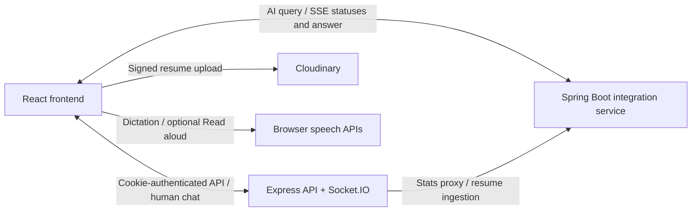

# DevTinder Frontend

DevTinder's React application for discovering developers, managing connections, sharing resumes, and chatting with people or an AI recruiter.

This repository is the frontend. The Express API and Spring Boot integration service remain separate repositories.

## Features

- **Accounts:** cookie-based login, signup with email OTP verification, profile editing, and logout.
- **Developer discovery:** swipeable candidate cards, connection requests, accepted connections, and GitHub, Codeforces, and LeetCode statistics.
- **Request notifications:** the header loads pending requests after sign-in, shows a count with a gentle ripple, and refreshes on navigation, focus, reconnecting online, and every minute while visible. Reviewing requests updates the shared list and badge.
- **Human chat:** real-time text messaging over Socket.IO, with persisted history loaded from the backend.
- **AI recruiter:** a signed-in-only side panel with a fixed animated glass-globe launcher. The dedicated AI route opens the same conversation. Received task updates show a ripple on the current task; completed steps stay still.
- **Voice dictation:** optional English speech-to-text in both chats, with editable drafts and explicit sending.
- **Read aloud:** optional browser speech playback for completed AI answers.
- **Resumes:** upload, replace, and remove PDFs; inspect validated resume citations beside an AI conversation on desktop or in an overlay on mobile.
- **Visual design:** dark navy backgrounds, subtle geometric detail, a responsive header, compact chat composers, keyboard focus states, and reduced-motion support.

## Stack and architecture

| Area | Technology |
| --- | --- |
| Application | React 19, Vite 7, React Router 7 |
| State | Redux Toolkit and React context for transient chat state |
| Styling | Tailwind CSS 4, daisyUI, scoped CSS |
| Animation | Framer Motion for swipe cards; SVG/CSS for chat decoration |
| Networking | Axios, Fetch with SSE parsing, Socket.IO client |
| Feedback | react-toastify |
| Voice | Browser speech recognition and speech synthesis; no additional voice provider |



The integration service owns AI orchestration and its Gemini, Redis, MongoDB, and Pinecone integrations. Service setup is documented in its own repository.

### Development and production URLs

| Traffic | Development | Production |
| --- | --- | --- |
| HTTP API | Vite `/api` proxy to `VITE_API_URL` | Direct to `VITE_API_URL` |
| AI SSE | Vite `/integration-api` proxy to `VITE_STATS_SERVICE_URL` | Direct to `VITE_STATS_SERVICE_URL` |
| Human WebSockets | Direct to `VITE_API_URL` | Direct to `VITE_API_URL` |
| Developer statistics | Backend `/stats` endpoint | Backend `/stats` endpoint |

The local HTTP proxies preserve cookies and avoid cross-port browser preflights. They are development-server features, not part of the production build.

## Local development

### Prerequisites

- Node.js **20.19+ on the 20.x line, or 22.12+**, as required by Vite 7.
- The `dev-Tinder-backend` API, normally at `http://localhost:7777`.
- For enabled AI chat, a running `integration-service`, normally at `http://localhost:8080`.

Start the backend and integration service separately using their respective READMEs. Starting Docker Desktop alone does not start the integration service.

### Install and configure

From the workspace containing the three repositories:

```powershell
cd dev-Tinder-frontend
npm ci

# Preserve an existing local configuration.
if (!(Test-Path .env)) { Copy-Item .env.example .env }
```

Configure the frontend's `.env`:

```env
VITE_API_URL=http://localhost:7777
VITE_STATS_SERVICE_URL=http://localhost:8080
VITE_AI_CHAT_ENABLED=true
```

Use service base URLs without endpoint suffixes. Set `VITE_AI_CHAT_ENABLED=false` if the integration service is not being used.

Only the exact value `true` enables AI chat. A false or missing flag hides the launcher and blocks frontend AI queries, while human chat remains available. AI chat is also unavailable until the existing cookie session resolves to a signed-in account.

`VITE_*` values are public browser configuration. Keep Gemini, database, Redis, Cloudinary signing, and other secret credentials in the server services, not here. Local `.env` files are ignored by Git.

### Start

```sh
npm run dev
```

Open `http://localhost:5173` by default. Restart Vite after changing environment variables. For local AI connectivity, check the integration service's `/api/ping` endpoint before sending a query.

## Chat and voice behavior

### Text and drafts

Human chat uses the existing authenticated `GET /chat/:targetUserId` history endpoint and Socket.IO `joinChat`, `sendMessage`, and `messageReceived` events. AI chat posts `{ query, userId }` to `/api/chat/stream` and consumes its existing SSE events.

- Enter sends; Shift+Enter inserts a newline.
- Drafts are separate for each conversation and stay in memory.
- Closing the AI panel preserves its conversation and pending query; reopening does not resubmit it.
- Logout, account changes, or a reload clear transient drafts and the AI transcript. Human message history remains on the backend.
- Opening an existing answer or resume preview does not issue another AI query.
- The notification count represents **pending connection requests**, not unread chat messages. Refreshing it uses the existing HTTP endpoint; it is not an instant push-notification channel.

### Dictation and playback

1. Click the microphone to start English (`en-IN`) dictation.
2. Stop and review the confirmed transcript, or Cancel to restore the original draft.
3. Edit the text and explicitly Send.

Capture ends after at most 60 seconds, or earlier if the browser ends recognition. Stopping, silence, or recognition completion never sends a message automatically. Typing remains available when speech recognition is unsupported or fails.

Desktop Chrome and Android Chrome are the primary browser targets. Brave can expose speech APIs while its recognition service is unavailable; the UI offers Chrome or device-keyboard dictation as fallbacks. Recognition requires HTTPS or localhost and microphone permission. The browser may process speech remotely.

**Read aloud** is available on completed successful AI answers when browser synthesis is supported. It speaks prose and descriptive link labels, omitting fenced code, raw URLs, internal resume identifiers, and separate citation lists. Starting dictation, closing the panel, navigating away, backgrounding, or logging out stops playback.

DevTinder sends dictated messages through the existing **text** contracts. It does not upload or persist voice recordings.

### Resume previews

Click a resume citation or a source button to preview its PDF. Desktop previews appear to the left of the AI conversation; mobile previews overlay it. The preview supports returning to chat and opening the file in a new tab.

Source validity is checked when opening the panel, regaining focus, every 30 seconds while open, and before opening a PDF. Resume-change events also invalidate affected answers. Retired sources are removed from those answers and open previews, with a prompt to ask again.

These validity checks make no AI-generation or embedding calls. Uploading and indexing a new PDF still uses the integration service's embedding pipeline.

## Routes

| Route | Screen |
| --- | --- |
| `/login` | Login, signup, and OTP verification |
| `/` | Developer feed |
| `/profile` | Own profile and resume management |
| `/profile/:userId` | Another developer's profile |
| `/requests` | Pending connection requests |
| `/connections` | Accepted connections |
| `/chat/:targetUserId` | Human conversation |
| `/chat/ai-agent` | Shared AI recruiter panel; signed-out users return to login |

## Important files

| Path | Responsibility |
| --- | --- |
| `src/App.jsx` | Providers and routes |
| `src/components/Body.jsx`, `NavBar.jsx` | Session restoration, app shell, navigation, request refresh, logout |
| `src/components/Login.jsx`, `OtpCoundown.jsx` | Login/signup/OTP flow |
| `src/components/Feed.jsx`, `UserCard.jsx` | Discovery, swiping, platform statistics |
| `src/components/Requests.jsx`, `RequestCard.jsx` | Shared request list and accept/reject actions |
| `src/components/Chat.jsx` | Human history and socket lifecycle |
| `src/components/AiDrawerLayout.jsx` | AI panel, conversation, citations, preview validation |
| `src/components/ResumeSection.jsx`, `ResumePreview.jsx` | Resume management and PDF preview |
| `src/components/chat/` | Shared shell, composer, globe, Markdown, task status, and chat provider |
| `src/contexts/ChatExperienceContext.js` | Shared transient chat experience context |
| `src/hooks/useAgenticChat.js` | SSE lifecycle, cancellation, and error handling |
| `src/hooks/useVoiceDictation.js`, `useReadAloud.js`, `useChatScroll.js` | Speech and conversation scrolling |
| `src/utils/speechRuntime.js`, `speechText.js`, `chatMessages.js` | Speech ownership, readable text, and message normalization |
| `src/utils/appStore.js`, `*Slice.js` | Redux account/feed/connection/request state |
| `src/utils/constants.js`, `socket.js` | API targets, AI flag, Socket.IO factory |
| `src/styles/auth.css`, `site.css`, `chat.css` | Authentication, application chrome, and chat styling |
| `vite.config.js` | React/Tailwind plugins and local proxies |

## Scripts and verification

| Command | Purpose |
| --- | --- |
| `npm run dev` | Vite development server |
| `npm test` | Dependency-free tests using Node's built-in test runner |
| `npm run build` | Production output in `dist/` |
| `npm run preview` | Local preview of the production build |
| `npm run lint` | Repository-wide ESLint checks |

Tests cover local API/SSE proxies, stream parsing, resume references and safe preview URLs, message normalization, dictation ownership/cancellation/error handling, and spoken-text conversion/playback.

Real microphone permissions, browser recognition services, native speech voices, and two-user/live-provider flows also need browser testing. Utility tests do not establish those external services' availability. Repository-wide lint contains existing findings in older components.

## Deployment notes

The frontend is deployed on Netlify. Build with `npm run build` and publish `dist`. The existing `public/_redirects` provides the single-page application fallback needed for direct route navigation.

Configure production `VITE_API_URL` and `VITE_STATS_SERVICE_URL` with the services' HTTPS base URLs. Never use localhost for a public deployment: it refers to each visitor's own computer. Backend cookie/CORS and Socket.IO origin settings must allow the frontend origin.

Vite embeds the environment values and AI flag at build time. A changed value requires a new build; open browser tabs must reload to receive it. The AI flag and signed-in UI gate control this frontend's behavior, not authorization or spending limits on direct integration-service requests.

## Feature documentation

- [Chat UI and voice requirements](docs/chat-voice-ui/requirements.md)
- [Implementation plan and subsequent UI decisions](docs/chat-voice-ui/implementation-plan.md)

The implementation plan's follow-up sections record the later approvals: side-panel presentation, fixed glass globe, current-task ripples, signed-in-only AI access, and the refreshed app header/background.
